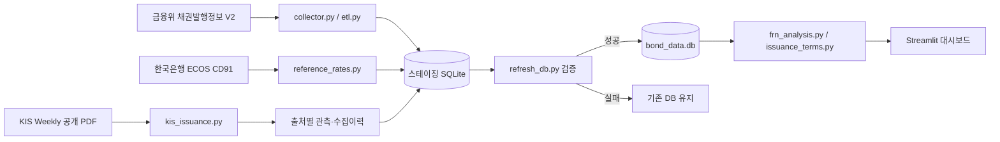

# Korea Bank FRN Tracker 개발명세서

- 문서 버전: 2.0
- 기준일: 2026-10-24
- 구현 상태: 운영 가능한 로컬 분석 도구
- 저장소: <https://github.com/KOJH-archive/korea-bank-frn-tracke>
- 주 실행 환경: Windows, Python 3, Streamlit, SQLite

## 1. 문서 목적

이 문서는 한국 은행권 변동금리채권(FRN)의 발행시장 규모와 **발행 당시 최초 가산금리**를 추적하는 시스템의 제품 범위, 데이터 계약, 처리 흐름, 화면, 검증, 보안 및 운영 기준을 정의한다.

개발자에게는 구현 기준과 변경 시 지켜야 할 불변조건을, 분석 사용자에게는 수치가 무엇을 의미하고 무엇을 의미하지 않는지를 제공한다. 코드와 문서가 충돌하면 현재 구현을 우선 확인하고, 의도된 변경이라면 코드와 본 문서를 함께 갱신한다.

## 2. 제품 목표와 원칙

은행이 특정 시점에 특정 원만기의 FRN을 발행할 때 적용한 `기준금리 + 가산금리(bp)`를 종목 단위로 보존하고 시계열로 비교한다.

대표 질문은 다음과 같다.

- 신한은행 1년물의 민평4사 AAA CD 1개월 대비 최초 가산금리는 2022년 이후 어떻게 움직였는가?
- 하나은행 1.5년물 신규 발행 조건 `CD + 59bp`는 과거 동일 조건에서 어느 수준인가?
- 시중은행 5개사의 연도별 직선형 FRN 발행액과 발행건수는 얼마인가?
- 전체 후보 중 원문 발행조건까지 확인된 비율과 미확보 사유는 무엇인가?

구현 불변조건은 다음과 같다.

1. 최초 발행조건과 발행 후 리셋된 표면금리를 분리한다.
2. 서로 다른 기준금리 산정방식은 같은 시계열로 합치지 않는다.
3. 원문이 없는 값은 추정해 채우거나 0으로 표시하지 않는다.
4. 확정값에는 원문 URL, PDF 페이지, 원문 산식과 수집 근거를 남긴다.
5. DB 갱신은 스테이징 검증을 통과한 경우에만 운영 DB에 반영한다.
6. API 키, 원문 PDF, 로컬 DB와 실행 결과는 Git 저장소에 올리지 않는다.

## 3. 범위

### 3.1 포함 범위

- 원화 은행채 중 FRN 후보 탐지
- 시중은행 5개사(국민·신한·하나·우리·농협)의 시장 규모 분석
- 발행일부터 변동금리인 직선형 FRN 기본 집계
- 사용자가 선택한 경우 고정→변동 전환형 포함
- KIS Weekly 공개 PDF의 변동금리채권 발행현황 수집
- ISIN, 발행일, 만기일, 발행액 교차검증
- 최초 발행 가산금리와 정확한 기준금리 코드 저장
- 은행·원만기·기준금리·기간별 시계열과 타행 비교
- 기준금리 일별 데이터 저장과 엄격한 조건을 만족하는 역산용 입력
- 수집 범위, 미확보 사유, 출처 충돌 및 보고서 오류 진단

### 3.2 제외 범위

- 지방채 및 지방채 통계
- 일반 채권시장 전체 대시보드
- 기관결제대금 통계를 이용한 화면 분석
- 유통수익률, 거래가격, 거래량 분석
- 발행 후 매 이자기간의 리셋금리 추적
- CD91을 민평3사/4사 AAA CD 1개월의 대용치로 사용하는 추정
- 불명확한 `CD + α`를 임의 기준금리 코드에 배정
- 미확보 기간의 보간, 전방/후방 채움 또는 0bp 대체

`bond_settlement_stat` 등 과거 호환 테이블과 함수는 마이그레이션 안정성을 위해 남아 있으나 현재 FRN 전용 화면에는 사용하지 않는다.

## 4. 용어와 분석 단위

- **직선형 FRN**: 발행일부터 변동금리를 적용하는 채권. 기본 시장 규모 집계 대상이다.
- **고정→변동 전환형**: 일정 기간 고정금리 적용 후 변동금리로 전환되는 채권. 기본 집계에서는 제외한다.
- **최초 발행 가산금리**: 발행조건 원문에 명시된 기준금리 대비 가산금리. 단위는 bp이다.
- **표면금리**: 금융위 종목 마스터의 현재 또는 등록 이율. 최초 가산금리와 동일한 개념이 아니다.
- **원만기**: 발행일에서 만기일까지의 실제 일수를 월수로 환산한 값.
- **후보 모집단**: 공식 변동금리 코드, 종목명 패턴 또는 별도 조건으로 탐지한 은행 FRN 후보.
- **확정 표본**: 원문에서 산식을 읽고 금융위 마스터와 교차검증한 `CONFIRMED` 종목.
- **관측값**: 하나의 출처가 제공한 종목별 발행조건.
- **대표값**: 동일 종목의 여러 관측 중 최초 발행조건으로 보존하는 값.

## 5. 기능 요구사항

### 5.1 공통 범위와 발행시장 규모

- **FR-001**: 사용자는 시중은행 5개 중 하나 이상과 발행일 범위를 선택할 수 있어야 한다.
- **FR-002**: 기본 날짜는 로컬 후보 범위 안에서 2022-01-01 이후여야 한다.
- **FR-003**: 기본 집계는 `STRAIGHT_FRN`만 포함해야 한다.
- **FR-004**: 토글을 켠 경우에만 `FIXED_TO_FLOAT`를 포함해야 한다.
- **FR-005**: 은행 미선택 또는 불완전한 날짜 입력 시 계산을 중단하고 안내해야 한다.
- **FR-101**: 총 발행액, 발행 종목 수, 직선형 FRN 수, 최근 발행일을 표시해야 한다.
- **FR-102**: 연도·은행별 발행액 누적 막대그래프와 연도별 합계 표를 제공해야 한다.
- **FR-103**: 은행별 누적 발행액과 고유 ISIN 건수를 제공해야 한다.
- **FR-104**: 발행액은 원 단위 원자료를 조원 단위 소수 셋째 자리까지 표시해야 한다.

### 5.2 가산금리 추이

- **FR-201**: 은행, 원만기, 정확한 기준금리 산정방식, 기간으로 표본을 제한해야 한다.
- **FR-202**: 여러 원만기를 동시에 선택해 개별 발행 종목을 비교할 수 있어야 한다.
- **FR-203**: 비교 차트의 점 크기는 발행액, 색상은 원만기를 나타내야 한다.
- **FR-204**: 툴팁에 발행일, 원만기, 가산금리, 발행액, ISIN, 원문 산식을 표시해야 한다.
- **FR-205**: 상세 차트에는 개별 발행점과 최근 5개 발행의 이동 중앙값을 표시해야 한다.
- **FR-206**: 이동 중앙값의 정렬 기준은 `발행일 → ISIN`이어야 한다.
- **FR-207**: 입력 가산금리의 백분위는 동일 은행·원만기·기준금리 표본이 5건 이상일 때만 제공해야 한다.
- **FR-208**: 백분위는 동률에 중간순위를 적용해야 한다.
- **FR-209**: 같은 기간·원만기·기준금리의 타행 표본을 비교할 수 있어야 한다.
- **FR-210**: 상세내역과 원문 링크를 표시하고 UTF-8 BOM CSV로 내려받을 수 있어야 한다.
- **FR-211**: 표본이 없는 조건은 0bp가 아니라 미확보로 표시해야 한다.
- **FR-212**: `신한은행 · 2022년부터 1년/1.5년 비교` 단축 버튼을 제공해야 한다.
- **FR-213**: `하나은행 1.5년 1CD+59bp` 형태의 빠른 입력을 해석해야 한다.
- **FR-214**: 빠른 입력의 `1CD`는 CD 1개월 후보로만 해석하고 민평3사/4사를 자동 결정하지 않아야 한다.

### 5.3 데이터 품질

- **FR-301**: 후보 건수, 원문 확인 건수, 건수 확보율, 발행액 확보율을 표시해야 한다.
- **FR-302**: 연도별·은행별 후보와 원문 확인 표본을 비교해야 한다.
- **FR-303**: 건수 확보율을 `미흡`, `부분 확보`, `양호`로 구분해야 한다.
- **FR-304**: 미확보를 보고서 범위 밖, 범위 내 미매칭, 불명확 산식, 미지원 기준, 구조 제외, 충돌 등으로 분류해야 한다.
- **FR-305**: 보고서 상태, 파서 버전, 해시, 대상기간, 파싱/제외 행 수와 오류를 조회할 수 있어야 한다.
- **FR-306**: CD91 일별 데이터의 건수와 보유 기간을 별도 기준자료로 표시해야 한다.

### 5.4 수집과 갱신

- **FR-401**: 금융위 API의 모든 페이지를 수집하고 `totalCount`와 실제 수신 건수를 대조해야 한다.
- **FR-402**: FSC 종목 마스터는 ISIN 기준 UPSERT하고 성공일·수신 건수를 기록해야 한다.
- **FR-403**: 기간 내 KIS Weekly 보고서를 찾아 PDF를 수집해야 한다.
- **FR-404**: PDF와 파싱 JSON은 해시와 파서 버전이 같을 때 재사용해야 한다.
- **FR-405**: 파서 버전이 바뀌면 같은 PDF도 다시 파싱해야 한다.
- **FR-406**: 보고서의 대상 발행기간을 읽지 못하면 해당 보고서를 실패 처리해야 한다.
- **FR-407**: 원문 조건은 ISIN·발행일·만기일·발행액이 마스터와 모두 일치할 때만 저장해야 한다.
- **FR-408**: 같은 종목·출처·원문 재수집은 중복 행을 만들지 않아야 한다.
- **FR-409**: 새로운 관측이 기존 대표값과 다르면 덮어쓰지 않고 `CONFLICT`로 격리해야 한다.
- **FR-410**: 전체 갱신은 스테이징 DB에서 수행하고 검증 성공 후에만 운영 DB를 교체해야 한다.
- **FR-411**: 교체 전 운영 DB 백업을 생성하고 실패 시 기존 DB를 유지해야 한다.

## 6. 비기능 요구사항

- **NFR-001 재현성**: 확정값에서 출처 URL, 페이지, 원문, 보고서 해시, 파서 버전을 추적할 수 있어야 한다.
- **NFR-002 무결성**: 종목 수, 최신 발행일, 확정 최초조건 수가 후퇴하면 교체를 차단해야 한다.
- **NFR-003 멱등성**: 같은 API·보고서를 반복 수집해도 중복 종목과 관측을 만들지 않아야 한다.
- **NFR-004 보존성**: 최초 대표 가산금리는 리셋 표면금리나 후속 보고서로 자동 덮어쓰지 않아야 한다.
- **NFR-005 보안**: API 키와 로컬 데이터 산출물을 소스 저장소에서 제외해야 한다.
- **NFR-006 성능**: DB 파일이 바뀌지 않은 Streamlit 재실행에서는 원자료 읽기를 캐시해야 한다.
- **NFR-007 접근성**: 차트와 표에는 내용을 설명하는 대체 텍스트를 제공해야 한다.
- **NFR-008 실패 격리**: ECOS 실패는 FSC 마스터 적재 결과와 구분해 경고로 기록해야 한다.
- **NFR-009 투명성**: 후보 모집단과 원문 확정 표본을 같은 수치처럼 표현하지 않아야 한다.

## 7. 시스템 아키텍처



### 7.1 모듈 책임

- `app.py`: Streamlit 진입점, 전역 필터, 가산금리 화면, 캐시와 세션 상태.
- `dashboard_views.py`: 발행시장 규모, 데이터 품질, 미확보 사유.
- `frn_analysis.py`: 발행사 정규화, 은행군, FRN 구조, 원만기, 백분위.
- `frn_parser.py`: 사용자의 빠른 조건 입력 해석.
- `collector.py`, `etl.py`: 금융위 V2 호출, 전수 페이징, 마스터 UPSERT, 워터마크.
- `kis_issuance.py`: 보고서 탐색, PDF 캐시, 파싱, 적재.
- `issuance_terms.py`: 출처 이력과 최초 발행조건 검증·보존.
- `reference_rates.py`: ECOS CD91 수집, 기준금리와 역산 조건 CSV 검증.
- `db.py`: SQLite 스키마, 연결, 공통 UPSERT.
- `refresh_db.py`: 스테이징 DB 감사, 백업과 원자적 교체.
- `config.py`: 로컬 환경변수 파일과 DB 경로.
- `tests/`: 단위·통합·Streamlit 회귀 테스트.

## 8. 외부 데이터 소스

### 8.1 금융위 채권발행정보 V2

- 엔드포인트: `GetBondTradInfoService_V2/getIssuIssuItemStat_V2`.
- 용도: 전체 채권 마스터와 공식 금리유형 확보.
- 핵심 필드: ISIN, 종목명, 발행사, 발행일, 만기일, 발행액, 통화, 표면금리, 금리변동 코드·명칭, 이자유형.
- 수집: 페이지당 1,000건, 전 페이지 순회, 수신 건수 일치 검증.
- 인증: 공공데이터포털 `API_KEY`.

### 8.2 KIS Weekly

- 목록: <https://www.bond.co.kr/post/10106/10254>
- 용도: 최초 발행 산식과 가산금리 원문.
- 검색: 목록 최대 100페이지, 요청 시작일보다 오래된 보고서 또는 마지막 페이지에서 종료.
- PDF: 마지막 12페이지에서 `변동금리채권 발행현황` 부록 탐색.
- 캐시: `data/kis_reports/`의 PDF·JSON·manifest. Git 제외.

### 8.3 한국은행 ECOS

- 통계코드 `817Y002`, 항목코드 `010502000`, 일별 주기 `D`.
- 용도: CD 91일물 일별 기준금리 저장.
- 인증: 선택 사항인 `ECOS_API_KEY`.
- 제한: CD91은 민평3사/4사 AAA CD 1개월과 다른 시계열이며 대용치로 사용할 수 없다.

### 8.4 사용자 CSV

기준금리 CSV 형식:

```text
benchmark_code,rate_date,rate_value,source[,published_at]
```

FRN 조건 CSV 필수 열:

```text
isin_code,benchmark_code,confidence_status
```

`INFERRED` 역산은 `fixing_date`, `reference_rate`, `coupon_rate_at_issue`, `fixing_lag_bdays`, `source_ref`가 모두 필요하며 동일 날짜·동일 코드의 기준금리 원자료와 일치해야 한다.

## 9. 데이터 모델

### 9.1 마스터와 메타데이터

- `issuer_mapping`: PK `issuer_id`; 발행사명, 섹터, 신용등급, 갱신일.
- `bond_master`: PK `isin_code`; FK `issuer_id`; 종목명, 발행/만기일, 발행액, 통화, 표면금리, 금리·이자유형.
- `etl_metadata`: PK `meta_key`; `last_fsc_sync_date`, `last_fsc_total_count` 등 완료 워터마크.

날짜는 `YYYYMMDD` 문자열, 발행액은 원 단위로 저장한다.

### 9.2 최초 발행조건

- `frn_issue_observations`: 출처별 원문 관측. `(isin_code, source_ref, raw_terms)` 유일성으로 중복을 막는다.
- `frn_issue_terms`: ISIN별 최초 대표값. 기준금리, 가산금리, 원문, 출처, 페이지, 리셋 주기, 신뢰상태를 보존한다.
- `frn_source_reports`: 보고서 ID, 일자, URL, 파서 버전, SHA-256, 상태, 대상기간 JSON, 파싱/제외 수, 오류.
- `frn_source_failures`: 해시 기반 실패 ID, 보고서, ISIN, 페이지, 사유, 원문 텍스트.

보고서 상태는 `PARSED`, `FAILED`다. 대표값 상태는 `CONFIRMED`, `CONFLICT`를 사용한다.

### 9.3 기준금리와 별도 일반 조건

- `reference_rate_daily`: 복합 PK `(benchmark_code, rate_date)`; 금리(%), 출처, 공표·적재일.
- `frn_terms`: 수동 확인·역산을 포함하는 일반 FRN 조건. 상태는 `CONFIRMED`, `INFERRED`, `UNVERIFIED`, `CONFLICT`.

최초 발행 전용 차트는 `frn_issue_terms`를 사용하며 `frn_terms`를 자동 혼합하지 않는다.

### 9.4 호환용 테이블

- `bond_supply_flow`: 발행·만기 이벤트. `(isin_code, event_date, event_type)` 유일 인덱스.
- `bond_settlement_stat`: 월별 기관결제대금. 현재 화면에서 사용하지 않는다.

## 10. 핵심 분류와 계산 규칙

### 10.1 발행사 정규화

`주식회사`, `㈜`, 공백을 제거하고 알려진 은행명 포함 여부를 검사한다. 주요 별칭은 한국산업은행→산업은행, 한국수출입은행→수출입은행, 중소기업은행/IBK기업은행→기업은행, KB국민은행→국민은행, 한국스탠다드차타드은행→SC제일은행, 대구은행→iM뱅크다.

핵심 비교 목록은 `국민은행`, `신한은행`, `하나은행`, `우리은행`, `농협은행`이다.

### 10.2 FRN 후보와 구조

다음 중 하나면 후보로 본다.

1. 금융위 `rate_type_code`가 `2` 또는 `3`.
2. 금리유형명·종목명에 `변동`, `(변)`, `-변`, `FRN`, `FLT`, `CD+`, `KOFR` 패턴 존재.
3. 별도 `frn_terms`에 기준금리 코드 존재.

구조는 코드 2 또는 확인 조건이면 `STRAIGHT_FRN`, 코드 3 또는 `고정 + 변동` 문구면 `FIXED_TO_FLOAT`, 나머지는 `OTHER_FLOATING`이다. 고정→변동 판정이 우선한다.

### 10.3 원만기 구간

월수는 `(만기일 - 발행일).일수 / (365.25 / 12)`로 계산한다. 구간은 왼쪽 포함·오른쪽 미포함이다.

| 표시 | 월수 구간 |
|---|---:|
| 6개월 | 0–7.5 미만 |
| 9개월 | 7.5–10.5 미만 |
| 1년 | 10.5–13.5 미만 |
| 1.25년 | 13.5–16.5 미만 |
| 1.5년 | 16.5–19.5 미만 |
| 1.75년 | 19.5–22.5 미만 |
| 2년 | 22.5–30 미만 |
| 3년 | 30–48 미만 |
| 5년 | 48–90 미만 |
| 10년 | 90 이상 |

### 10.4 기준금리와 KIS 파서

| 코드 | 의미 |
|---|---|
| `CD1M_M3_AAA` | 민평3사 AAA CD 1개월 |
| `CD1M_M4_AAA` | 민평4사 AAA CD 1개월 |
| `CD91` | CD 91일물 |

세 코드는 상호 대체하거나 합산하지 않는다. 파서 버전 3은 공백·대소문자를 정규화한 뒤 전체 산식이 다음 패턴과 정확히 일치할 때만 저장한다.

- `민평3사/4사 AAA [등급] CD 1개월|1M ±숫자 bp|%`
- `91일물 CD`, `91물 CD`, `CD 91일물`, `CD 91일 ±숫자 bp|%`

`%` 단위 가산금리는 100을 곱해 bp로 변환한다. 부분일치나 유사 문구는 추정하지 않는다.

### 10.5 제외 사유

- `FIXED_TO_FLOAT`: 고정 후 변동되는 복합형.
- `KOFR_OR_RFR`: KOFR, lookback 등 RFR 산식.
- `CP_BENCHMARK`: CP 기준.
- `CD_BASIS_UNSPECIFIED`: CD 기간 또는 민평3사/4사 AAA 기준 불명확.
- `OTHER_CREDIT_CURVE`: 지원하지 않는 민평 신용곡선.
- `UNPARSED_ROW`: PDF 행 구조 인식 실패.
- `UNSUPPORTED_FORMULA`: 그 밖의 미지원 산식.
- `CONFLICT`: 동일 ISIN의 출처별 기준금리 또는 가산금리 불일치.

### 10.6 마스터 교차검증과 대표값

ISIN 존재, 은행 발행사, 발행일·만기일·발행액 일치를 모두 통과해야 저장한다. 실패 코드는 `UNKNOWN_ISIN`, `NOT_BANK`, `DATE_MISMATCH`, `AMOUNT_MISMATCH`다.

관측의 `(benchmark_code, spread_bps)` 고유 조합이 하나면 `CONFIRMED`, 둘 이상이면 `CONFLICT`다. 최초 대표 숫자는 유지하고 충돌 시 상태만 갱신한다. 대시보드 가산금리 통계에는 `CONFIRMED`만 사용한다.

### 10.7 통계식

- 발행액: 후보 종목 `issue_amount` 합계. 가산금리 평균의 가중치로 사용하지 않는다.
- 발행건수: 고유 ISIN 수.
- 건수 확보율: 확정 ISIN / 후보 ISIN × 100.
- 금액 확보율: 확정 종목 발행액 / 후보 발행액 × 100.
- 이동 추세: 발행일·ISIN 정렬 후 최근 5건 중앙값.
- 백분위: `(입력값 미만 수 + 0.5 × 동일값 수) / 전체 수 × 100`.
- 백분위 최소 표본: 5건.

## 11. 갱신 파이프라인

1. 운영 DB를 스테이징 DB로 복제한다.
2. 금융위 API 전 페이지를 수집해 마스터와 발행·만기 이벤트를 UPSERT한다.
3. `ECOS_API_KEY`가 있으면 2020-01-01부터 실행일까지 CD91을 수집한다.
4. 기본 2024-01-01 이후 KIS 보고서를 찾고 PDF 해시·파서 버전으로 캐시를 검증한다.
5. 보고서 마지막 12페이지의 부록과 대상기간을 확인한다.
6. KRW 지원 산식만 파싱하고 마스터 대조 후 관측·대표값을 저장한다.
7. 보고서와 행별 실패 정보를 DB와 로컬 JSON에 기록한다.
8. 스테이징 검증 성공 후 운영 DB를 백업하고 원자적으로 교체한다.

스테이징 승격 조건은 다음과 같다.

- FSC 수신 수가 기존 전체의 90% 미만으로 급감하지 않음.
- 전체 종목 수가 감소하지 않음.
- 최신 발행일이 후퇴하지 않음.
- `CONFIRMED` 최초 조건 수가 감소하지 않음.
- `last_fsc_sync_date`가 실행일과 일치함.

ECOS 실패는 경고로 격리한다. 검증 전 실패하면 기존 DB를 유지하고 스테이징 DB를 검토용으로 남긴다.

## 12. Streamlit 화면 명세

### 12.1 공통

- wide 레이아웃, `발행시장 규모 / 가산금리 추이 / 데이터 품질` 세그먼트.
- 사이드바에 은행, 발행일, 고정→변동 포함 여부, 수집 현황.
- DB 초기화는 `st.cache_resource`.
- 데이터 로딩은 `st.cache_data(max_entries=3)`.
- 캐시 키는 DB 수정시각(ns)과 파일 크기.
- 은행·원만기·기준금리·비교 만기·입력값은 `st.session_state`로 유지.

### 12.2 발행시장 규모

- KPI 4개, 연도별 은행 누적 막대, 연도 합계 표, 은행 누계 표.
- 모든 차트와 표에 설명형 대체 텍스트를 제공한다.

### 12.3 가산금리 추이

- 빠른 조건 입력과 신한은행 사전설정 버튼.
- 은행·원만기·기준금리 선택과 다중 원만기 점 그래프.
- 동일 조건 표본 수, 중앙값, 최근값, 입력값 백분위.
- 개별 발행점과 최근 5건 중앙값 선.
- 원문 링크가 포함된 상세 표와 CSV 다운로드.
- 동일 조건 타행 비교와 은행별 요약.
- 빈 기간은 연결·보간하지 않는다.

### 12.4 데이터 품질과 하단 도구

- 후보 대비 확정 건수·금액 확보율, 연도·은행별 현황.
- 미확보 사유 분포, 종목 상세, 보고서별 수집 상태와 오류.
- 수집 범위·미확보 종목, 충돌 경고.
- CD91 일별 시계열과 다른 기준금리 CSV 업로드.

## 13. 오류 처리와 복구

- 네트워크 오류: 요청별 최대 2회 재시도 후 실패.
- FSC 오류 코드·빈 응답·건수 불일치: 워터마크를 갱신하지 않고 실패.
- PDF가 아닌 응답·대상기간 미검출: 보고서 실패.
- 행 파싱 실패: 전체 보고서를 버리지 않고 행별 실패로 기록.
- 날짜·금액 불일치: 해당 관측만 거부.
- 출처 불일치: `CONFLICT` 격리.
- ECOS 실패: 키를 `[REDACTED]` 처리하고 경고 기록.
- DB 검증 실패: 기존 운영 DB 유지.

## 14. 보안과 저장소 정책

로컬 `.env`에는 다음 키를 둔다.

```text
API_KEY=공공데이터포털_키
ECOS_API_KEY=한국은행_ECOS_키
```

Git 제외 대상:

- `.env`, `Public.env`, Streamlit secrets 등 인증정보
- `*.db`, WAL, SHM, 자동 백업과 스테이징 DB
- `data/kis_reports/` 원문 PDF, 파싱 캐시, manifest
- `data/*.json` 수집·감사·갱신 결과
- 가상환경, 캐시, 로그, 개인용 산출물

저장소에는 코드, 테스트, 빈 입력 양식, 문서, 민감정보 없는 예시 스크린샷만 포함한다. SQLite 쓰기는 값 바인딩을 사용하며 날짜와 유한 숫자를 검증한다. 단순 `CD` 또는 `1CD`는 저장용 확정 기준금리 코드로 허용하지 않는다.

## 15. 설치와 실행

고정 의존성:

```text
streamlit==1.66.1
pandas==3.1.0
altair==6.3.0
pdfplumber==0.11.10
```

최초 설치:

```powershell
py -m venv .venv
.\.venv\Scripts\python.exe -m pip install -r requirements.txt
Copy-Item .env.example .env
```

실행:

- `run_dashboard_offline.bat`: 기존 DB로 화면만 실행.
- `run_dashboard.bat`: 갱신 성공 후 화면 실행.
- `refresh_db.bat`: 갱신과 검증만 실행.

```powershell
.\.venv\Scripts\streamlit.exe run app.py
.\.venv\Scripts\python.exe refresh_db.py
.\.venv\Scripts\python.exe refresh_db.py --audit-only
.\.venv\Scripts\python.exe kis_issuance.py --start 20240101 --end 20261024
.\.venv\Scripts\python.exe kis_issuance.py --start 20240101 --end 20261024 --cached-only
```

## 16. 테스트 명세

```powershell
.\.venv\Scripts\python.exe -B -m unittest discover -s tests -v
```

현재 자동 테스트 8개는 다음을 검증한다.

1. 공식 코드 기반 직선형·고정→변동형 분리.
2. 기본 시장 범위의 고정→변동형 제외.
3. 민평3사/4사 AAA CD1M과 CD91 변형 파싱.
4. 미지원 산식의 명시적 제외 사유.
5. 대상기간과 행별 실패를 반영한 미확보 사유.
6. 재수집 멱등성과 최초값 보존.
7. 발행일·만기일·발행액 불일치 차단.
8. 다른 기준금리·가산금리 관측의 충돌 격리.

Streamlit 통합 테스트는 임시 복제 DB에서 발행시장, 데이터 품질, 신한은행 2022년 이후 1년/1.5년 단축 조회, 가산금리 차트와 상세 표를 회귀 검증한다.

완료 판정은 전체 테스트, `git diff --check`, DB 감사 통과와 민감 파일 비추적이다.

## 17. 2026-10-24 검증 스냅샷

아래 값은 로컬 DB 감사 결과이며 DB 파일 자체는 저장소에 포함하지 않는다.

- 전체 채권: 86,574건.
- 최신 발행일: 2026-10-21.
- 표면금리·금리유형 적재: 각각 86,574건.
- 금융위 공식 변동금리 코드 후보: 3,954건.
- 전체 은행 원문 최초 발행조건: 429건.
- CD91 일별 데이터: 1,675건.
- 마지막 FSC 전수 수집 완료일: 2026-10-23.

시중은행 5개 직선형 FRN의 2022년 이후 집계:

| 연도 | 후보 건수 | 후보 발행액 | 원문 확정 건수 | 확정 발행액 |
|---:|---:|---:|---:|---:|
| 2022 | 99 | 22.190조원 | 0 | 0.000조원 |
| 2023 | 68 | 13.470조원 | 0 | 0.000조원 |
| 2024 | 11 | 2.430조원 | 11 | 2.430조원 |
| 2025 | 29 | 7.485조원 | 15 | 5.020조원 |
| 2026 | 108 | 25.090조원 | 94 | 21.320조원 |
| **합계** | **315** | **70.665조원** | **120** | **28.770조원** |

건수 확보율은 38.1%, 발행액 확보율은 40.7%다. 2022~2023년 확정 0건은 확인한 KIS 보고서에 해당 부록이 없어 자동 수집하지 못한 결과이며 FRN 미발행을 뜻하지 않는다.

## 18. 알려진 한계와 개선 우선순위

### 알려진 한계

1. KIS 부록이 없는 과거 기간은 현재 자동 수집만으로 복원할 수 없다.
2. 민평3사/4사 AAA CD 1개월의 신뢰 가능한 일별 원자료가 없어 해당 기준 쿠폰 역산은 수행하지 않는다.
3. 공식 금리유형 코드와 종목명은 후보 탐지 수단이며 발행 산식 확정 근거가 아니다.
4. PDF 레이아웃 변경 시 행 파서와 마지막 12페이지 규칙을 갱신해야 할 수 있다.
5. 같은 날짜 여러 종목의 이동 통계 순서는 ISIN이며 장중 발행 순서를 뜻하지 않는다.
6. 로컬 단일 사용자 분석을 전제로 하며 서버용 인증·권한·동시 쓰기는 범위 밖이다.

### P0: 정확도와 커버리지

- 2022~2023년 원문 조건을 제공하는 대체 공식·공개 출처 조사와 수집기 추가.
- 민평3사/4사 AAA CD 1개월 일별 원자료의 이용 가능성·라이선스 확인.
- 복수 출처 합의와 충돌 검토 화면 강화.

### P1: 운영 자동화

- 정기 갱신과 실패 알림.
- PDF 파서 회귀용 비식별 고정 fixture.
- 갱신 전후 품질 변화 요약과 백업 보존정책.

### P2: 분석 기능

- 원만기·은행별 확보율 추이.
- 발행액 구간별 가산금리 분포.
- 충분한 표본의 월별 중앙값과 사분위 범위.
- 선택 조건의 공유·재현 기능.

## 19. 변경·배포 체크리스트

### 데이터와 파서

- [ ] 새 산식에 정확한 전체 일치 규칙과 테스트가 있는가?
- [ ] 기준금리 코드 의미가 기존 코드와 겹치지 않는가?
- [ ] 파서 변경 시 `PARSER_VERSION`을 올렸는가?
- [ ] 실패 사유와 화면 라벨을 함께 추가했는가?
- [ ] 대표값 보존과 충돌 격리 규칙을 유지하는가?

### 화면과 통계

- [ ] 후보와 확정 표본을 분리 표시하는가?
- [ ] 결측을 0이나 보간값으로 바꾸지 않는가?
- [ ] 차트·표에 대체 텍스트가 있는가?
- [ ] 고비용 로딩은 캐시되는가?
- [ ] 비교에 은행·원만기·기준금리·기간이 모두 적용되는가?

### 저장소 배포

- [ ] 자동 테스트와 DB 감사가 통과했는가?
- [ ] API 키와 개인 경로가 문서·로그·Git 이력에 없는가?
- [ ] DB, PDF, 수집 JSON이 추적되지 않는가?
- [ ] README와 본 명세서가 현재 구현과 일치하는가?

## 20. 인수 기준

1. 5개 시중은행의 2022년 이후 연도별 FRN 발행액·건수를 볼 수 있다.
2. 은행·원만기·기준금리별 원문 확정 가산금리를 종목 단위로 조회·다운로드할 수 있다.
3. CD1M 민평3사, CD1M 민평4사, CD91이 혼합되지 않는다.
4. 최초 발행 가산금리가 후속 표면금리로 덮어써지지 않는다.
5. 원문 미확보와 무발행을 구분한다.
6. 출처 충돌 종목이 통계에서 제외되고 감사 가능하다.
7. 갱신 실패 시 기존 DB가 유지된다.
8. 저장소에 인증정보와 로컬 데이터 파일이 포함되지 않는다.
9. 자동 테스트 8개가 모두 통과한다.
