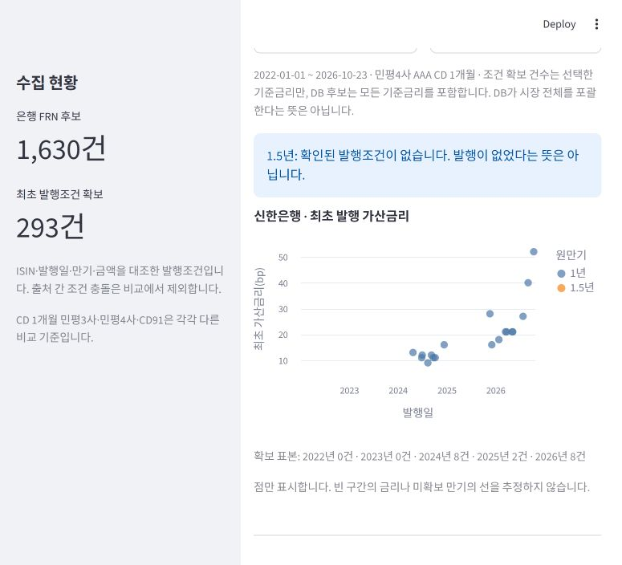

# Korea Bank FRN Tracker

한국 은행권 FRN의 발행시장 규모와 발행 당시 확정된 `CD + 가산금리(bp)`를 추적하는 로컬 Streamlit 대시보드입니다. 이후 리셋된 표면금리와 최초 발행조건을 분리하고, 모든 확정값에 원문 출처를 보존합니다.



## 핵심 기능

- 시중은행 5개사의 연도별 FRN 발행액·발행건수 비교
- 은행·원만기·기준금리별 최초 발행 가산금리 시계열
- KIS Weekly 원문 PDF의 종목번호·발행일·만기일·발행액 교차검증
- 민평3사 AAA CD 1개월, 민평4사 AAA CD 1개월, CD91의 엄격한 분리
- 원문 미확보·KOFR/RFR·CP·다른 민평곡선·출처 충돌의 사유별 품질 진단
- 검증 전 DB 교체 차단, 최초 발행조건 보존, CSV 다운로드

## 실행

### 처음 설치

```powershell
py -m venv .venv
.\.venv\Scripts\python.exe -m pip install -r requirements.txt
Copy-Item .env.example .env
```

`.env`에 공공데이터포털 API 키를 입력합니다. ECOS·OpenDART 키는 해당 수집 기능을 사용할 때만 필요합니다. 실제 키는 Git에 포함되지 않습니다.

### Windows 바로 실행

- 기존 데이터로 조회: `run_dashboard_offline.bat`
- 금융위 마스터·ECOS CD91·2024년 이후 공개 발행조건 갱신 후 조회: `run_dashboard.bat`
- 데이터 갱신만 실행: `refresh_db.bat`

데이터 없이 처음 실행하는 경우 먼저 `.env`를 설정한 뒤 `refresh_db.bat`을 실행합니다.

## 화면

1. 은행 / 발행 당시 원만기 / 정확한 기준금리 산정방식 / 발행일 범위 선택
2. 여러 원만기의 발행 가산금리 비교 및 개별 원만기의 최근 5건 중앙값
3. 종목별 발행조건 원문·원문 PDF 페이지 링크·CSV 다운로드
4. 같은 기간·만기·기준금리의 타행 비교와 입력 가산금리 백분위
5. 수집한 보고서 목록 및 최초 조건 미확보 종목 확인

빠른 입력 예: 하나은행 1.5년 1CD+59bp. 적용 버튼으로 은행·만기·입력 가산금리를 설정합니다. 1CD만으로는 민평3사/4사 기준이 결정되지 않아 아래에서 정확한 기준을 선택합니다.

## 실제 발행조건 수집

공개 KIS Weekly의 '변동금리채권 발행현황'에서 종목번호, 발행일, 만기일, FRN 산정방식, 발행액을 읽습니다.

    .venv\\Scripts\\python.exe kis_issuance.py --start 20260101 --end 20261023

네트워크 재호출 없이 보관된 보고서로 검증:

    .venv\\Scripts\\python.exe kis_issuance.py --start 20260101 --end 20261023 --cached-only

기간을 바꾸면 이전 연도 보고서도 조회할 수 있습니다. 기본 갱신은 부록 형식이 확인된 2024년 이후를 다시 검증합니다. 2022~2023년은 확인한 KIS 보고서에 해당 부록이 없어 자동으로 값을 만들지 않습니다. 전체 과거 이력이 완성된 것은 아닙니다.

### 신한은행 2022년 이후 조회 점검 (2026-10-23)

화면 상단의 '신한은행 · 2022년부터 1년/1.5년 비교' 버튼으로 재현할 수 있습니다.

- 동일 기준(민평4사 AAA CD 1개월)의 1년물: 18건, 발행일 2024-04-24~2026-10-15. 연도별 2024년 8건, 2025년 2건, 2026년 8건.
- DB의 신한은행 1년물 후보: 42건. 아직 조건이 미확보된 후보가 있으므로 이 그래프를 전체 발행 실적으로 해석하지 않습니다.
- 2022~2023년: 확인한 KIS 보고서에는 FRN 발행현황 부록이 없어 이 수집기로 가산금리를 확보하지 못했습니다.
- 1.5년물: 현재 DB 후보 및 검증 조건 모두 0건. 실제 발행이 없었다는 의미는 아닙니다.
- 미확보 기간은 빈 구간으로 두며 금리를 보간하거나 0bp로 채우지 않습니다.
- 과거 대조 도구: backfill_issuer.py / 세부 기록: data/shinhan_backfill_report.json.
- 구형 표기 AAA등급·CD1M·91물 CD 및 % 단위를 지원하며, 추출 캐시 버전 3으로 이전 파싱 결과를 재검증합니다.

- 출처: https://www.bond.co.kr/post/10106/10254
- 예: 2026-10-14 하나은행 1.5년 KR6004947GA5 / 민평4사 AAA CD 1개월+57bp
- 원문: https://www.bond.co.kr/post/dawn/37035#page=72

## 검증 및 보존

ISIN과 금융위 마스터의 발행일·만기일·발행액이 모두 일치한 은행 종목만 저장합니다. CONFIRMED는 출처에 가산금리가 명시되고 마스터 대조를 통과했다는 뜻이며 별도 발행사 확인을 받았다는 뜻은 아닙니다.

- frn_issue_observations: 출처별 원문 관측 이력(중복 방지)
- frn_issue_terms: 최초 발행조건 대표값
- 다른 출처에서 다른 기준금리나 가산금리가 나오면 CONFLICT로 격리하고 비교에서 제외
- 기존 대표 가산금리는 자동 덮어쓰지 않음
- 종목 마스터 표면금리가 바뀌어도 최초 발행조건은 보존
- 원문 PDF와 추출 캐시: data/kis_reports
- 수집 보고서: data/issuance_collection_report.json
- 보고서·파서 버전·해시·대상기간·행별 제외 사유: frn_source_reports / frn_source_failures
- 적재 전 백업: bond_before_issue_terms_날짜.db

데이터 품질 화면의 미확보 종목은 `원문 범위 밖`, `대상기간 내 미매칭`, `CD 세부 기준 불명확`, `KOFR/CP/다른 민평곡선`, `출처 충돌`로 구분됩니다. 자동 DB 교체는 기존 확정 최초조건 건수가 감소하면 중단됩니다.

민평3사 AAA CD 1개월(CD1M_M3_AAA), 민평4사 AAA CD 1개월(CD1M_M4_AAA), CD91을 별개 시계열로 관리합니다. KOFR·CP·복합형·불명확한 산식은 현재 CD 발행조건 수집에서 제외하고 사유를 보고서에 기록합니다. 가산금리는 발행액 가중 없이 개별 발행 기준으로 비교합니다.

## CD 금리와 역산

한국은행 ECOS CD91 일별 금리를 보관합니다. 민평 CD 1개월의 대용으로 사용하지 않습니다. 최초 적용금리와 실제 fixing 규칙·동일 기준금리 원자료가 확보됐을 때 역산할 수 있습니다. 기존 reference_rates.py의 CSV 역산 도구는 유지하지만 frn_terms에 저장된 기존 조건은 최초 발행 전용 차트에 자동 혼합하지 않습니다.

## 검증 명령

    .venv\\Scripts\\python.exe -B -m unittest discover -s tests -v
    .venv\\Scripts\\python.exe -B refresh_db.py --audit-only

DB·환경설정·기존 백업은 보관합니다. 일반 채권·지방채·시황 화면은 제공하지 않습니다.

## 저장소에 포함되는 것

저장소에는 애플리케이션 코드, 테스트, 빈 CSV 양식, 문서와 예시 화면만 포함합니다. 다음 항목은 크기·보안·재배포 문제 때문에 로컬에만 보관됩니다.

- `.env`, `Public.env` 등 API 키 파일
- `bond_data.db`와 자동 생성 백업 DB
- `data/kis_reports/`의 원문 PDF와 추출 캐시
- 수집·감사·갱신 결과 JSON

## 주요 구성

- `app.py`, `dashboard_views.py`: Streamlit 화면과 데이터 품질 대시보드
- `frn_analysis.py`: 은행·FRN 구조·원만기 분류
- `kis_issuance.py`, `issuance_terms.py`: KIS 원문 파싱, 출처 이력, 최초 발행조건 검증
- `etl.py`, `collector.py`, `reference_rates.py`: 금융위 종목정보와 기준금리 ETL
- `refresh_db.py`: 스테이징 DB 검증과 안전한 교체
- `tests/`: 파서·보존 규칙·실제 대시보드 회귀 테스트
